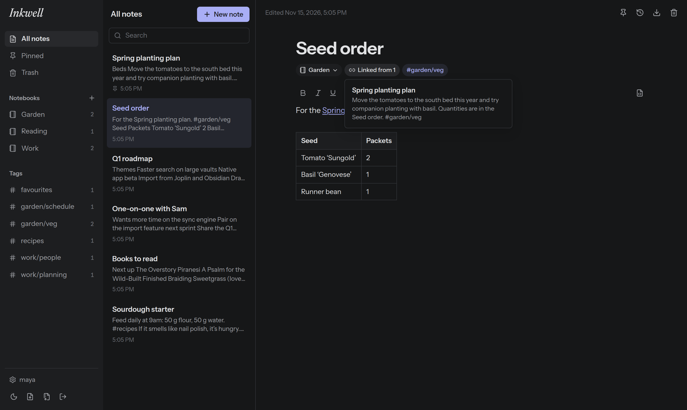
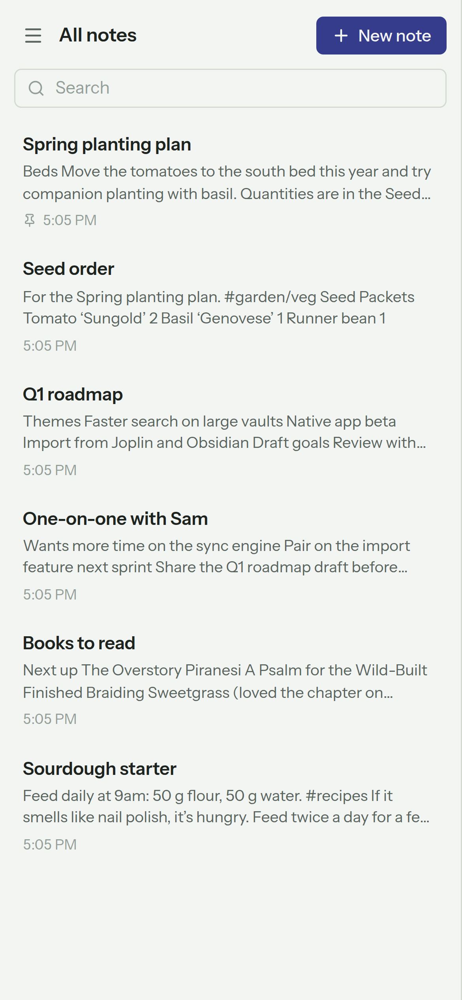

# Inkwell

A simple note-taking app you host yourself. Write in a live view that formats as you type (and stays plain Markdown underneath), find anything with full-text search, and keep everything in SQLite and a folder of attachments on your own server.


| Dark theme, with a note’s backlinks open | On a phone |
| --- | --- |
|  |   |

- One live view: you edit the formatted note directly, like Obsidian's Live Preview. Markdown symbols show only on the line you're editing, checkboxes tick with a click, and links and tags open with a click. **Show Markdown** on the toolbar switches to plain source.
- Formatting toolbar and shortcuts: bold, italic, underline, strikethrough, highlight, headings, bulleted/numbered/task lists, quotes, code, links and tables
- Full-text search with prefix matching
- Quick switcher (Ctrl/⌘+P) to jump to any note by typing part of its title, and a command palette (Ctrl/⌘+Shift+P) for everything else
- Images and file attachments: paste or drop them into a note; images show in the note, other files open with a click
- Notebooks to group notes, and inline `#tags` (nested like `#project/inkwell`) typed anywhere in a note
- `[[Wiki-links]]` between notes with title suggestions as you type, a “Linked from” list of backlinks on every note, and an offer to update links when you rename a note
- Version history: earlier versions of each note are kept as you edit; compare any of them with the note now and restore it (restoring can itself be undone)
- Pin notes, move them to the trash, restore them, or delete them for good
- Download any note as a `.md` file, or export everything as a zip (one folder per notebook)
- Import Markdown and Word (.docx) files, or a zip of them, such as an Obsidian vault, a Joplin Markdown export, or an Inkwell export
- Sign-in and sign-up rate limiting
- Multiple accounts per server, each with private notes; admins add, reset and remove accounts from Settings
- Change your password and sign out other devices from Settings
- Personal API tokens for scripts and apps, read & write or read only, created and revoked in Settings
- Light and dark themes, phone and desktop layouts
- No external requests: fonts and scripts are served by the app itself

## Run it with Docker

```bash
git clone https://github.com/sanitydub/inkwell.git
cd inkwell
cp .env.docker.example .env   # then edit .env
docker compose up -d
```

Open the address you set as `INKWELL_ORIGIN` (by default http://localhost:3000) and create the first account; it becomes the admin. Notes are stored in the `inkwell-data` Docker volume, so they survive restarts, upgrades and `docker compose down`.

Settings live in `.env`, next to `docker-compose.yml`:

- `INKWELL_PORT`: the port on your machine (default 3000). Change it if something else already uses 3000.
- `INKWELL_ORIGIN`: the exact address people type, including the port, e.g. `http://homeserver:3300` or `https://notes.example.com`.
- `ALLOW_REGISTRATION`: set to `false` once everyone has an account (the first account can always be created, and admins can still add people in Settings).

To upgrade, pull the latest code and rebuild: `git pull && docker compose up -d --build`.

Put it behind a reverse proxy with HTTPS (Caddy, Traefik, nginx) for anything beyond your LAN or tailnet. Session cookies are marked `Secure` automatically when the app is served over HTTPS.

## Run it without Docker

Requires Node.js 22.13 or newer (it uses Node's built-in SQLite).

```bash
npm ci
npm run build
DATA_DIR=./data ORIGIN=http://localhost:3000 node build
```

## Configuration

| Variable             | Default | Purpose                                                        |
| -------------------- | ------- | -------------------------------------------------------------- |
| `DATA_DIR`           | `data`  | Folder for `inkwell.db`. Created if missing.                   |
| `ALLOW_REGISTRATION` | `true`  | Whether new people can sign up. The first account always can, and admins can always add accounts. |
| `ORIGIN`             | —       | Public URL of the app. Needed in production.                   |
| `PORT`               | `3000`  | Port to listen on.                                             |
| `MAX_ATTACHMENT_SIZE` | `10M`  | Largest image or file one attachment may be. |
| `BODY_SIZE_LIMIT`    | `512K`  | Largest request accepted. Must be above `MAX_ATTACHMENT_SIZE` (the Docker image sets `25M`). |

Behind a proxy that terminates TLS, you can use `PROTOCOL_HEADER=x-forwarded-proto` and `HOST_HEADER=x-forwarded-host` instead of `ORIGIN`. See the [adapter-node docs](https://svelte.dev/docs/kit/adapter-node) for all server options.

### Behind a reverse proxy

Set `ADDRESS_HEADER=x-forwarded-for` (and `XFF_DEPTH=1` for a single proxy) so the app sees each visitor's real IP address. Without it, every request appears to come from the proxy, and visitors share one sign-in rate limit.

### Rate limits

To slow down password guessing, sign-in is blocked for 15 minutes after 10 failed attempts for one username or 20 from one IP address, and an IP address can create at most 5 accounts an hour. Wrong API tokens count as failed sign-ins for the IP address they come from. Counters are kept in memory and reset when the server restarts.

## Formatting

Notes are Markdown, and the toolbar above the editor writes it for you. Click a button again to remove the formatting.

| Format | Shortcut | Markdown |
| --- | --- | --- |
| Bold | Ctrl+B | `**text**` |
| Italic | Ctrl+I | `*text*` |
| Underline | Ctrl+U | `<u>text</u>` |
| Strikethrough | Ctrl+Shift+X | `~~text~~` |
| Highlight | Ctrl+Shift+H | `==text==` |
| Code | Ctrl+E | `` `text` `` (a fenced block for several lines) |
| Heading 1–3 | Ctrl+Alt+1 / 2 / 3 | `#`, `##`, `###` |
| Bulleted / numbered / task list | Ctrl+Shift+8 / 7 / 9 | `- `, `1. `, `- [ ] ` |
| Link | Ctrl+K (in the editor) | `[text](https://…)` |

Each line break shows as a new line, as in Obsidian; leave a blank line to start a new paragraph. On a Mac, use ⌘ instead of Ctrl. Quotes and tables are on the toolbar. Underline and highlight use the same syntax as Obsidian, so notes move between the two cleanly; Word imports keep both.

## Keyboard shortcuts

| Shortcut | What it does |
| --- | --- |
| Ctrl+P | Quick switcher: type a few letters of a title, in order, to find a note. With nothing typed it lists recently edited notes. If no note matches, Enter creates one with that title. |
| Ctrl+Shift+P | Command palette: new note, pin, trash or restore, history, download, Show Markdown, go to a view or notebook, theme, import, export, Settings, sign out |
| Ctrl+K | Search notes (inserts a link when you're in the editor) |
| Ctrl+S | Save now (notes also save as you type) |

On a Mac, use ⌘ instead of Ctrl. Firefox keeps Ctrl+Shift+P for private windows, so there (or anywhere) press Ctrl+P and type `>` to get the commands instead.

## Accounts

The first account created on a server is its admin. Everyone can open **Settings** (click your name at the bottom of the sidebar) to change their password, which signs out their other devices, or to sign out other devices directly. Settings also lists your attachments, shows which notes use each one, and can delete the ones no note links to. A file that only an earlier version of a note uses is marked “(history)” and counts as used, so restoring that version never shows a broken image. Unused files are never deleted automatically.

## Version history

The clock button above a note opens **History**. While you edit, Inkwell keeps the note as it was every 10 minutes, and before any big change (500 characters, or a third of a note longer than 100 characters, such as a large paste or deletion). Pick a version to see what's different from the note now, or switch to **Full version** to read it formatted. **Restore this version** puts its title and text back; the text it replaces is kept as a version first, so a restore can be undone the same way.

Versions thin out as they age: every version from the last day, one per hour for the last week, one per day before that, and at most 50 per note. They're deleted with the note, and aren't included in exports.

Admins also see **People on this server**, where they can:

- add accounts, even when `ALLOW_REGISTRATION=false`, which makes this the way to invite people to a closed server;
- reset someone's password, which signs them out everywhere;
- make someone an admin, or remove admin (there's always at least one admin);
- delete an account along with all its notes.


## Importing notes

Use **Import** at the bottom of the sidebar to bring in `.md`, `.txt` or Word `.docx` files, or `.zip` archives of them:

- Each file becomes a note. Its title comes from the YAML front matter (`title:`) if there is one, otherwise from the file name. `created`, `updated` and `pinned` in the front matter are kept too.
- Folders become notebooks. Nested folders get a combined name like “Projects / Atlas”, and a single folder wrapping the whole zip is ignored. Files go into an existing notebook if one has the same name.
- Front matter with anything beyond those keys (Obsidian `aliases`, `tags:` lists, …) stays in the note so nothing is lost.
- Word documents are converted to Markdown: headings, bold, italic and strikethrough, links, bulleted and numbered lists (nested too), quotes and tables come across. The note's title is the document's Title (from its properties or a Title-styled first line), otherwise the file name. Images, comments and footnotes are left out, and tracked changes are imported as accepted.
- Images and other files that a note links to, with a relative link or an Obsidian `![[embed]]`, become attachments. Files nothing links to, and app folders like `.obsidian/`, are skipped.
- Importing the same files twice creates duplicates.

Inkwell's own export imports back exactly, attachments included. Uploads are limited by `BODY_SIZE_LIMIT` (the Docker image allows 25 MB); raise it, or import in smaller batches, for big archives.

## Backups

To take your notes elsewhere, use **Export all notes** at the bottom of the sidebar (or `GET /api/export`). You get a zip with one folder per notebook and one Markdown file per note, each starting with a small YAML header (title, created and updated dates) that Obsidian, Joplin and most Markdown tools understand. Attachments go in an `attachments/` folder, and links in the notes point into it, so the export also opens in Obsidian. Notes in the trash and version history aren't included.


Everything lives in `DATA_DIR`: notes, notebooks and accounts in `inkwell.db`, and uploaded images and files in `attachments/`. Back up both. While the app is running, use SQLite's online backup for the database and copy the folder:

```bash
sqlite3 data/inkwell.db ".backup 'inkwell-backup.db'"
cp -r data/attachments attachments-backup
```

With Docker, both live in the `inkwell_inkwell-data` volume.

## Development

```bash
npm install
npm run dev          # http://localhost:5173
npm run check        # type-check
npm run screenshots  # regenerate docs/screenshots
```

`npm run screenshots` builds the app, runs it with a throwaway database of demo notes, and captures the README images with a Chromium-based browser (Brave, Chrome, Chromium or Edge; set `BROWSER_PATH` to choose one). Run it after visible UI changes and commit the updated images.

Stack: [SvelteKit](https://svelte.dev/docs/kit) 3 (Svelte 5), Node's built-in `node:sqlite` with FTS5, CodeMirror 6, marked + DOMPurify.

```
src/
  env.ts                  environment variables (validated at startup)
  hooks.server.ts         resolves the signed-in user from the session cookie
  lib/server/             database, migrations, auth, notes queries (server only)
  lib/workspace.svelte.ts client state: note list, open note, autosave
  lib/components/         Sidebar, NoteList, NotePane, Editor, Preview
  routes/api/             JSON API (also the API for future native clients)
```

### API

All endpoints take and return JSON. Sign in with either a session cookie (set by register or login) or a personal API token.

**API tokens.** Create one in **Settings → API tokens**, give it a name, choose **Read & write** or **Read only**, and pick when it expires (30 days, 90 days, a year, or never). It's shown once; Inkwell only stores a hash of it. Send it in the `Authorization` header:

```bash
curl -H "Authorization: Bearer ink_…" http://localhost:3000/api/notes
curl -H "Authorization: Bearer ink_…" -H "content-type: application/json" \
  -d '{"title":"From a script","content":"Hello #api"}' http://localhost:3000/api/notes
```

A token can do everything you can through the API except the routes under `/api/me/password`, `/api/me/sessions`, `/api/me/tokens` and `/api/admin`, which need you signed in on the website. Read-only tokens get `403` for anything but `GET`. Revoking a token, or deleting the account, stops it at once; changing your password doesn't. Requests that change data with a session cookie must come from the app's own origin (the `Origin` header); token requests don't need it.


| Method   | Path                  | Body / query                                  |
| -------- | --------------------- | --------------------------------------------- |
| `POST`   | `/api/auth/register`  | `{ username, password }`                      |
| `POST`   | `/api/auth/login`     | `{ username, password }`                      |
| `POST`   | `/api/auth/logout`    |                                               |
| `GET`    | `/api/me`             |                                               |
| `POST`   | `/api/me/password`    | `{ currentPassword, newPassword }`; signs out your other devices |
| `GET`    | `/api/me/sessions`    | how many other devices are signed in          |
| `DELETE` | `/api/me/sessions`    | signs out your other devices                  |
| `GET`    | `/api/me/tokens`      | your API tokens (never their secrets)         |
| `POST`   | `/api/me/tokens`      | `{ name, scope: "read" \| "write", expiresInDays: 30 \| 90 \| 365 \| null }`; returns `{ token, secret }`, the only time the secret is shown |
| `DELETE` | `/api/me/tokens/:id`  | revokes a token                               |
| `GET`    | `/api/admin/users`    | admins only: every account, with note counts  |
| `POST`   | `/api/admin/users`    | admins only: `{ username, password, isAdmin? }` |
| `PATCH`  | `/api/admin/users/:id`| admins only: `{ password?, isAdmin? }`        |
| `DELETE` | `/api/admin/users/:id`| admins only: deletes the account and its notes |
| `GET`    | `/api/notes`          | `?view=all\|pinned\|trash&q=…&notebook=<id>&tag=<name>` |
| `POST`   | `/api/notes`          | `{ title?, content?, notebookId? }`           |
| `GET`    | `/api/notes/:id`      |                                               |
| `PATCH`  | `/api/notes/:id`      | any of `{ title, content, notebookId, pinned, trashed }` |
| `DELETE` | `/api/notes/:id`      | permanent                                     |
| `DELETE` | `/api/trash`          | empties the trash                             |
| `GET`    | `/api/notebooks`      | notebooks with note counts                    |
| `POST`   | `/api/notebooks`      | `{ name }`                                    |
| `PATCH`  | `/api/notebooks/:id`  | `{ name }`                                    |
| `DELETE` | `/api/notebooks/:id`  | its notes are kept, without a notebook        |
| `GET`    | `/api/tags`           | tags in use, with note counts                 |
| `GET`    | `/api/export`         | zip of all notes outside the trash, with attachments |
| `POST`   | `/api/attachments`    | multipart form data, one or more `files`; returns each file's `url` and ready-to-insert `markdown` |
| `GET`    | `/api/attachments`    | your attachments, with the notes that link to each (`history: true` when only an earlier version does) |
| `GET`    | `/api/attachments/:id/:name` | the file (owner only); verified images display inline, other files download |
| `DELETE` | `/api/attachments/:id` | deletes one attachment |
| `DELETE` | `/api/attachments?unused=true` | deletes attachments no note links to |
| `POST`   | `/api/import`         | multipart form data, one or more `files` (.md, .txt, .docx, .zip) |
| `GET`    | `/api/titles`         | every note title (for resolving links)        |
| `GET`    | `/api/notes/:id/backlinks` | notes that `[[link]]` here, with the linking line |
| `GET`    | `/api/notes/:id/relink` | `?from=<old title>`: notes whose links would move to this note's current title |
| `POST`   | `/api/notes/:id/relink` | `{ from }`: rewrites those links to the current title |
| `GET`    | `/api/notes/:id/versions` | earlier versions, newest first, without their text |
| `GET`    | `/api/notes/:id/versions/:vid` | one version with its `title` and `content` |
| `POST`   | `/api/notes/:id/versions/:vid/restore` | puts that version back (keeping the current text as a version first); returns the note |
| `GET`    | `/api/health`         |                                               |

Links work the same way: `[[Title]]` or `[[Title|shown text]]` in note content is indexed on save and matched to note titles ignoring case, so when you rename a note, Inkwell offers to point the links at the new title (`POST /api/notes/:id/relink`), keeping any `#heading` and display text.

Tags are read from `#words` in note content on every save (ignoring code), so there's no tag endpoint to write to. Filtering by `tag=project` also matches nested tags like `project/inkwell`.

Errors look like `{ "status": 404, "message": "…" }`. Rate-limited requests get status `429` with a `Retry-After` header in seconds.

### Database changes

Migrations are the `migrations` array in `src/lib/server/db.ts`, tracked with SQLite's `user_version`. Add a new entry for each change; never edit one that has shipped.

## License

Inkwell is free software, licensed under the [GNU Affero General Public License v3.0 or later](LICENSE). If you run a modified version for other people over a network, you must offer them its source code.
