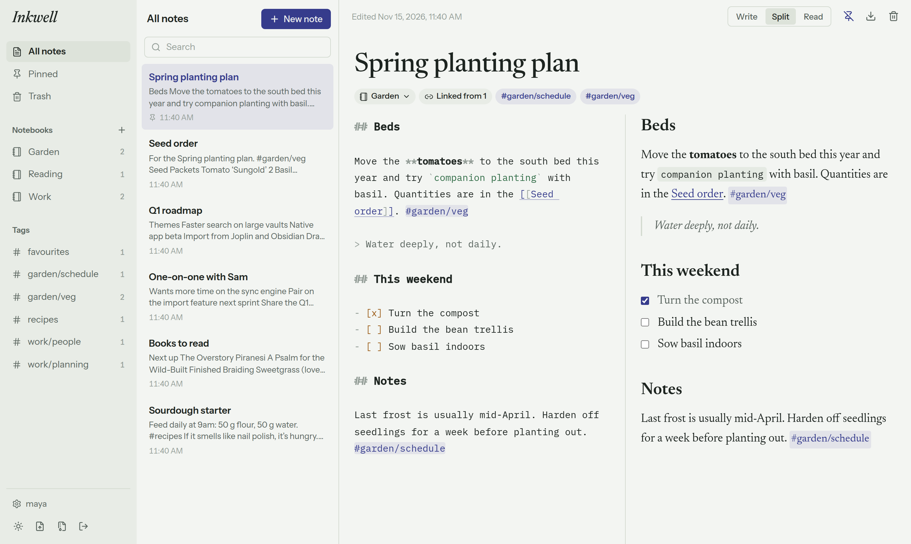
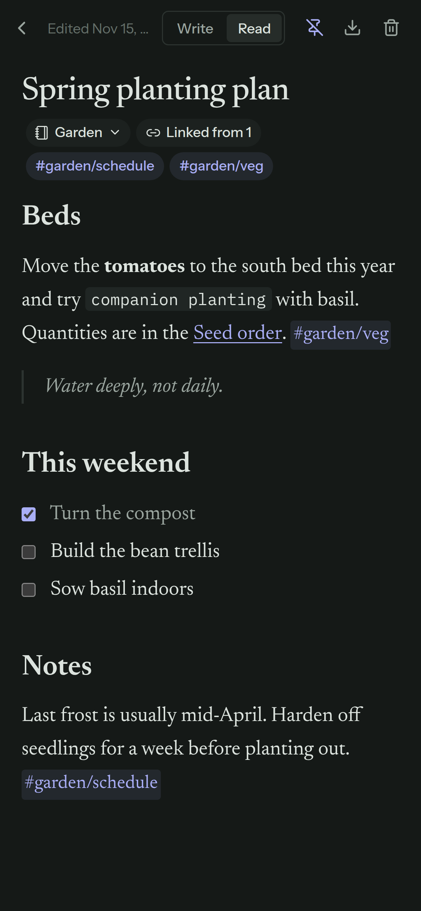
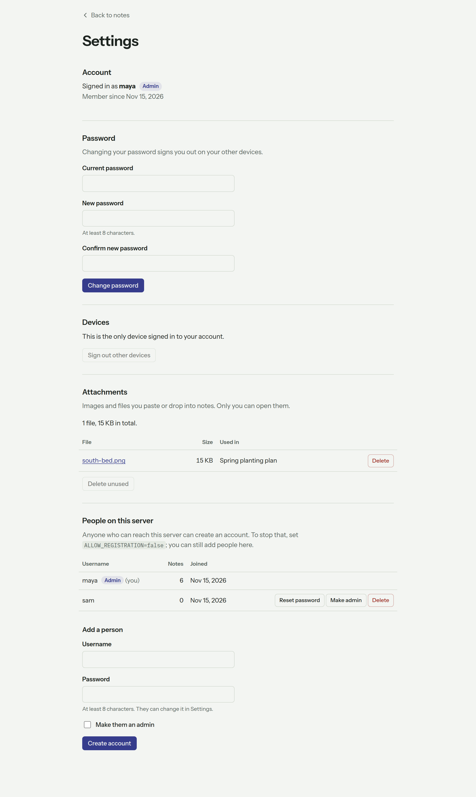

# Inkwell

A simple note-taking app you host yourself. Write in Markdown with a live preview, find anything with full-text search, and keep everything in a single SQLite file on your own server.



| Dark theme, with a note’s backlinks open | On a phone |
| --- | --- |
|  |   |

- Markdown editor (CodeMirror) with Write, Split and Read layouts; tick `- [ ]` tasks right in the rendered note
- Full-text search with prefix matching
- Notebooks to group notes, and inline `#tags` (nested like `#project/inkwell`) typed anywhere in a note
- `[[Wiki-links]]` between notes with title suggestions as you type, plus a “Linked from” list of backlinks on every note
- Pin notes, move them to the trash, restore them, or delete them for good
- Download any note as a `.md` file, or export everything as a zip (one folder per notebook)
- Import Markdown files or a zip, such as an Obsidian vault, a Joplin Markdown export, or an Inkwell export
- Sign-in and sign-up rate limiting
- Multiple accounts per server, each with private notes; admins add, reset and remove accounts from Settings
- Change your password and sign out other devices from Settings
- Light and dark themes, phone and desktop layouts
- No external requests: fonts and scripts are served by the app itself

## Run it with Docker

```bash
docker compose up -d
```

Open http://localhost:3000 and create the first account. Notes are stored in the `inkwell-data` volume.

Before exposing it to a network, edit `docker-compose.yml`:

- `ORIGIN`: the exact address people use, e.g. `https://notes.example.com`
- `ALLOW_REGISTRATION`: set to `"false"` once everyone has an account (the first account can always be created, and admins can still add people in Settings)

Put it behind a reverse proxy with HTTPS (Caddy, Traefik, nginx) for anything beyond your LAN. Session cookies are marked `Secure` automatically when the app is served over HTTPS.

## Run it without Docker

Requires Node.js 22.13 or newer (it uses Node's built-in SQLite).

```bash
npm ci
npm run build
DATA_DIR=./data ORIGIN=http://localhost:3000 node build
```

## Configuration

| Variable             | Default | Purpose                                                        |
| -------------------- | ------- | -------------------------------------------------------------- |
| `DATA_DIR`           | `data`  | Folder for `inkwell.db`. Created if missing.                   |
| `ALLOW_REGISTRATION` | `true`  | Whether new people can sign up. The first account always can, and admins can always add accounts. |
| `ORIGIN`             | —       | Public URL of the app. Needed in production.                   |
| `PORT`               | `3000`  | Port to listen on.                                             |
| `BODY_SIZE_LIMIT`    | `512K`  | Largest request accepted (Docker image sets `10M` for big notes). |

Behind a proxy that terminates TLS, you can use `PROTOCOL_HEADER=x-forwarded-proto` and `HOST_HEADER=x-forwarded-host` instead of `ORIGIN`. See the [adapter-node docs](https://svelte.dev/docs/kit/adapter-node) for all server options.

### Behind a reverse proxy

Set `ADDRESS_HEADER=x-forwarded-for` (and `XFF_DEPTH=1` for a single proxy) so the app sees each visitor's real IP address. Without it, every request appears to come from the proxy, and visitors share one sign-in rate limit.

### Rate limits

To slow down password guessing, sign-in is blocked for 15 minutes after 10 failed attempts for one username or 20 from one IP address, and an IP address can create at most 5 accounts an hour. Counters are kept in memory and reset when the server restarts.

## Accounts

The first account created on a server is its admin. Everyone can open **Settings** (click your name at the bottom of the sidebar) to change their password, which signs out their other devices, or to sign out other devices directly.

Admins also see **People on this server**, where they can:

- add accounts, even when `ALLOW_REGISTRATION=false`, which makes this the way to invite people to a closed server;
- reset someone's password, which signs them out everywhere;
- make someone an admin, or remove admin (there's always at least one admin);
- delete an account along with all its notes.



## Importing notes

Use **Import** at the bottom of the sidebar to bring in `.md` or `.txt` files, or `.zip` archives of them:

- Each file becomes a note. Its title comes from the YAML front matter (`title:`) if there is one, otherwise from the file name. `created`, `updated` and `pinned` in the front matter are kept too.
- Folders become notebooks. Nested folders get a combined name like “Projects / Atlas”, and a single folder wrapping the whole zip is ignored. Files go into an existing notebook if one has the same name.
- Front matter with anything beyond those keys (Obsidian `aliases`, `tags:` lists, …) stays in the note so nothing is lost.
- Images, attachments and app folders like `.obsidian/` are skipped.
- Importing the same files twice creates duplicates.

Inkwell's own export imports back exactly. Uploads are limited by `BODY_SIZE_LIMIT` (the Docker image allows 10 MB); raise it, or import in smaller batches, for big archives.

## Backups

To take your notes elsewhere, use **Export all notes** at the bottom of the sidebar (or `GET /api/export`). You get a zip with one folder per notebook and one Markdown file per note, each starting with a small YAML header (title, created and updated dates) that Obsidian, Joplin and most Markdown tools understand. Notes in the trash aren't included.


Everything lives in `DATA_DIR/inkwell.db`. To back it up while the app is running, use SQLite's online backup:

```bash
sqlite3 data/inkwell.db ".backup 'inkwell-backup.db'"
```

## Development

```bash
npm install
npm run dev          # http://localhost:5173
npm run check        # type-check
npm run screenshots  # regenerate docs/screenshots
```

`npm run screenshots` builds the app, runs it with a throwaway database of demo notes, and captures the README images with a Chromium-based browser (Brave, Chrome, Chromium or Edge; set `BROWSER_PATH` to choose one). Run it after visible UI changes and commit the updated images.

Stack: [SvelteKit](https://svelte.dev/docs/kit) 3 (Svelte 5), Node's built-in `node:sqlite` with FTS5, CodeMirror 6, marked + DOMPurify.

```
src/
  env.ts                  environment variables (validated at startup)
  hooks.server.ts         resolves the signed-in user from the session cookie
  lib/server/             database, migrations, auth, notes queries (server only)
  lib/workspace.svelte.ts client state: note list, open note, autosave
  lib/components/         Sidebar, NoteList, NotePane, Editor, Preview
  routes/api/             JSON API (also the API for future native clients)
```

### API

All endpoints take and return JSON. Authentication is a session cookie set by register or login.

| Method   | Path                  | Body / query                                  |
| -------- | --------------------- | --------------------------------------------- |
| `POST`   | `/api/auth/register`  | `{ username, password }`                      |
| `POST`   | `/api/auth/login`     | `{ username, password }`                      |
| `POST`   | `/api/auth/logout`    |                                               |
| `GET`    | `/api/me`             |                                               |
| `POST`   | `/api/me/password`    | `{ currentPassword, newPassword }`; signs out your other devices |
| `GET`    | `/api/me/sessions`    | how many other devices are signed in          |
| `DELETE` | `/api/me/sessions`    | signs out your other devices                  |
| `GET`    | `/api/admin/users`    | admins only: every account, with note counts  |
| `POST`   | `/api/admin/users`    | admins only: `{ username, password, isAdmin? }` |
| `PATCH`  | `/api/admin/users/:id`| admins only: `{ password?, isAdmin? }`        |
| `DELETE` | `/api/admin/users/:id`| admins only: deletes the account and its notes |
| `GET`    | `/api/notes`          | `?view=all\|pinned\|trash&q=…&notebook=<id>&tag=<name>` |
| `POST`   | `/api/notes`          | `{ title?, content?, notebookId? }`           |
| `GET`    | `/api/notes/:id`      |                                               |
| `PATCH`  | `/api/notes/:id`      | any of `{ title, content, notebookId, pinned, trashed }` |
| `DELETE` | `/api/notes/:id`      | permanent                                     |
| `DELETE` | `/api/trash`          | empties the trash                             |
| `GET`    | `/api/notebooks`      | notebooks with note counts                    |
| `POST`   | `/api/notebooks`      | `{ name }`                                    |
| `PATCH`  | `/api/notebooks/:id`  | `{ name }`                                    |
| `DELETE` | `/api/notebooks/:id`  | its notes are kept, without a notebook        |
| `GET`    | `/api/tags`           | tags in use, with note counts                 |
| `GET`    | `/api/export`         | zip of all notes outside the trash            |
| `POST`   | `/api/import`         | multipart form data, one or more `files` (.md, .txt, .zip) |
| `GET`    | `/api/titles`         | every note title (for resolving links)        |
| `GET`    | `/api/notes/:id/backlinks` | notes that `[[link]]` here, with the linking line |
| `GET`    | `/api/health`         |                                               |

Links work the same way: `[[Title]]` or `[[Title|shown text]]` in note content is indexed on save and matched to note titles ignoring case, so renaming a note means updating the links that point to it.

Tags are read from `#words` in note content on every save (ignoring code), so there's no tag endpoint to write to. Filtering by `tag=project` also matches nested tags like `project/inkwell`.

Errors look like `{ "status": 404, "message": "…" }`. Rate-limited requests get status `429` with a `Retry-After` header in seconds.

### Database changes

Migrations are the `migrations` array in `src/lib/server/db.ts`, tracked with SQLite's `user_version`. Add a new entry for each change; never edit one that has shipped.

## License

Inkwell is free software, licensed under the [GNU Affero General Public License v3.0 or later](LICENSE). If you run a modified version for other people over a network, you must offer them its source code.
